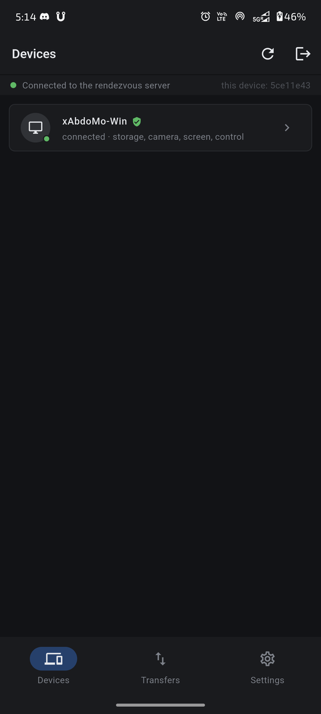
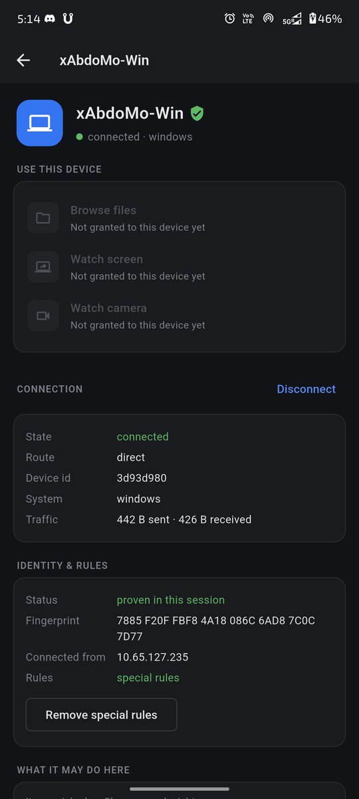
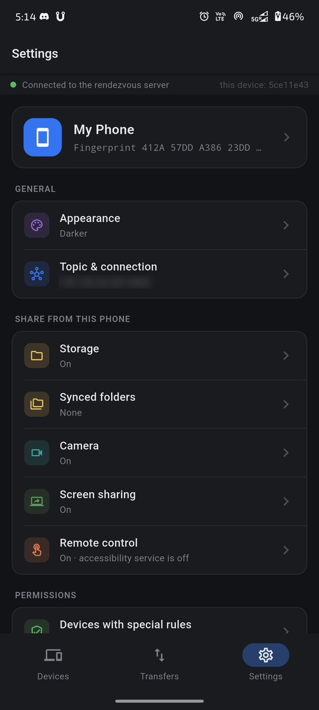
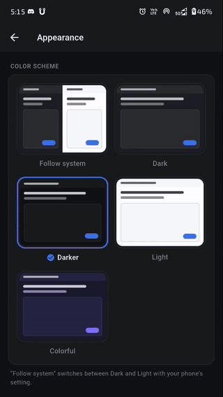
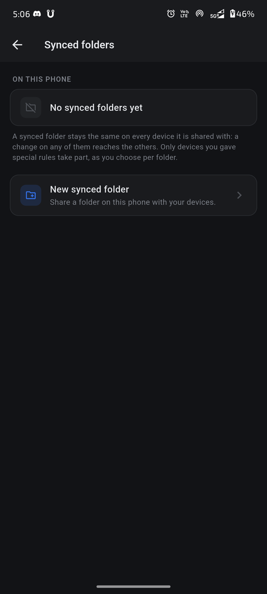
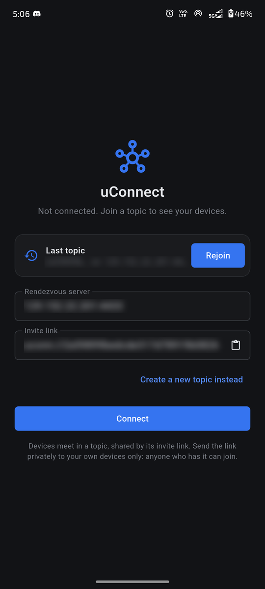

<h1 align="center">uConnect Mobile</h1>

<p align="center">
  Your phone, connected to your computers: files both ways, synced folders,
  screen and camera sharing, and remote control, end-to-end encrypted. The
  Flutter companion to <a href="https://github.com/AbdoWise-z/uconnect-desktop">uConnect Desktop</a>.
</p>

<p align="center">
  <a href="https://github.com/AbdoWise-z/uconnect-mobile/releases">Download</a> ·
  <a href="https://github.com/AbdoWise-z/uconnect-desktop/blob/master/docs/protocol.md">Protocol</a>
</p>

> **Beta.** uConnect is in public beta: expect rough edges, and keep backups of
> anything you sync.

## Features

- **Topics and invite links.** Devices meet in a *topic*, shared by an
  invite link. Scan a computer's invite QR code from the first page or
  Settings › Topic (the app's own scanner, which also reads a code out of a
  picture), with the system camera (`uconn://` links open the app), or paste
  the link. Leave a topic at any
  time; the connect page offers to rejoin it.
- **Your rules, per device.** Every service is behind a permission, and each
  device gets what all of these grant it, together:
  1. its **special rules** — permissions of its own, added after checking its
     fingerprint;
  2. this topic's **network rules** — ordered address patterns such as
     `m.m.m.x` (your own subnet) or `100.x.x.x`, matched against the address
     its direct connection comes from (the first match applies);
  3. your **defaults**.

  The device's page marks which of them grants each permission. Make its
  special rules an **exception** to apply only those, for example to give it
  less than the defaults.

  Rules are per topic, and a device can copy another device's network rules
  for quick setup on a trusted network; the list shows each device's
  fingerprint, since names can be copied.
- **Storage, both ways.** Browse, download and upload files in the folders
  your computers share, and share folders from the phone, with read-only
  shares. Downloads resume and every file is checked against its SHA-256.
- **Folder sync.** Keep a folder the same on the phone and your computers,
  with conflicts kept rather than overwritten. Only devices with special rules
  take part, and you choose per folder who is sent it and whose changes you
  take.
- **Screen, camera and control.** Watch a computer's screen or camera, and
  share the phone's own screen and camera, each behind a consent prompt
  unless that device's rules allow it without asking. A computer can control
  the phone (taps, swipes, typing) through the accessibility service you
  enable. You choose the resolution, frame rate (up to 120 fps, 60 by
  default) and bitrate you receive. Video travels the way real-time services
  send it (paced packets with repair, repeats within a round trip, a
  bandwidth estimate the encoder follows, a quality ladder for thin paths),
  so sharing over mobile data stays within a fraction of a second; pictures
  play back at the pace they were captured after a buffer that follows the
  network (or one you choose), and a statistics overlay shows how both
  devices keep up. Sharing has its own limits in Settings.
- **Stays connected.** A foreground service keeps the session alive in the
  background, and ends it cleanly when the app closes.
- **Searchable settings.** The search field at the top of Settings finds
  single settings, says where each is, and opens its page pointing at it.
  How the phone watches other devices (the quality to ask for and the
  playback buffer) has its own page, Use other devices › Watching.
- **Color schemes.** Follow system, Dark, Darker, Light or Colorful.

### Screenshots

<p align="center">
  
  
  
</p>
<p align="center">
  <sub>The devices in a topic · a computer's page, with where it connects from and which rules apply · settings</sub>
</p>
<p align="center">
  
  
  
</p>
<p align="center">
  <sub>Color schemes switch live · synced folders · offline, with the last topic ready to rejoin</sub>
</p>

## How it works

Devices find each other through a **rendezvous server**, which introduces
them and then gets out of the way: they connect directly, punching through
NAT where they can, or fall back to the server's relay, which carries only
ciphertext it cannot read. Networking comes from the
[uconnect](https://github.com/AbdoWise-z/uconnect) library, compiled into the
app and driven over Dart FFI; the app protocol on top is specified in
[uconnect-desktop's docs/protocol.md](https://github.com/AbdoWise-z/uconnect-desktop/blob/master/docs/protocol.md).
Video is H.264, encoded and decoded in hardware through Android's MediaCodec.

## Getting started

1. Set up [uConnect Desktop](https://github.com/AbdoWise-z/uconnect-desktop)
   on your computers, with a rendezvous server both it and the phone can reach.
2. Install uConnect Mobile (the APK from the
   [releases](https://github.com/AbdoWise-z/uconnect-mobile/releases)) and
   give it the server's address (`host:port`).
3. Join the topic: scan the invite QR code a computer shows (Topic → Show Invite QR Code)
   or paste its link. Send invite links privately: anyone who has one can join.
4. On each device's page, compare fingerprints and **add special rules** to
   the devices you own, then choose what they may do. For a home network, a
   network rule such as `m.m.m.x` can cover them all at once.

## Building

Requirements: Flutter 3.47+, the Android SDK with NDK r27 and CMake (the
uconnect C library is cross-compiled into the app by Gradle), and for the
host-side tests a desktop C++20 toolchain.

```sh
flutter pub get
flutter build apk            # or: flutter run
```

### Tests

Protocol and FFI tests run on the host against a real uconnect build,
rendezvous server included:

```powershell
powershell -File scripts/build-host.ps1   # builds uconnect_c + the server
powershell -File scripts/test.ps1         # unit + loopback E2E
```

End to end on a connected Android device (everything runs over the USB cable
via `adb reverse`): the suite builds the app, installs it, and drives the real
device through identity verification, listing, download, upload and file
operations against a host peer.

```powershell
powershell -File scripts/e2e-android.ps1
```

## Platforms

|                                   | Android 9+ | iOS |
|-----------------------------------|:----------:|:---:|
| Browse / download / upload        | ✓ | planned |
| Share folders from the phone      | ✓ | planned |
| Folder sync                       | ✓ | planned |
| Watch a screen or camera          | ✓ | planned |
| Share the phone's screen / camera | ✓ | — |
| Be controlled                     | ✓ (accessibility service) | — |
| Invite links and QR codes         | ✓ | ✓ (untested) |

iOS needs the uconnect library built as a static XCFramework and a Mac to
build on; the Dart side is platform-independent and ready for it.

## Known issues and next up

Where the app stands (updated 2026-10-24):

- **Streaming over mobile data** holds a lag budget of a second: the phone's
  screen reaches a desktop at 30 fps/480p on a ~1 Mbit/s uplink with 10%
  loss, and the phone watches a desktop at 60+ fps over its downlink. Media
  travels over UDP only (direct or relayed); there is no TCP fallback.
- The phone keeps its connections to desktops alive every 5 s: carrier NATs
  were found to forget a quiet TCP connection within half a minute.
- The stream view shows a live line (size, fps, rate, lag), a one-screen
  quality sheet and self-hiding controls in full screen.
- **Open:** one viewer at a time when the phone shares; `test/app_smoke_test.dart`
  hangs (pre-existing); iOS has not been built.
- **Next up:** bandwidth probing when the encoder has little to send, temporal
  layering so the frame rate can drop without a resize.

## License

MIT, like the rest of uConnect. See [LICENSE](LICENSE).
